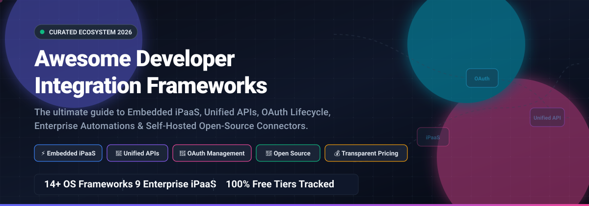

# 🔌 Awesome-Developer-Integration-Framework

  

  
  
  
  
  
  

---

## 📖 Overview & SEO Summary

> **The definitive, curated landscape of Developer Integration Frameworks, Embedded iPaaS, Unified APIs, OAuth Management, Workflow Automation Engines, and Self-Hosted Connectors.** 🚀

Whether you are building customer-facing B2B SaaS integrations, orchestrating distributed microservices, synchronizing multi-cloud data pipelines, or managing complex third-party OAuth 2.0 connection lifecycles, this directory tracks industry-leading **Enterprise SaaS Platforms** alongside production-ready **Open-Source GitHub Frameworks**.

### 🔍 Quick Highlights
- ⚡ **Embedded iPaaS (e-iPaaS):** Native white-label integration connectors for SaaS customer workflows.
- 🔌 **Unified APIs:** Standardized schemas across CRMs, ERPs, HRIS, and ticketing systems.
- 🔐 **OAuth Lifecycle Management:** Frictionless frontend auth modals, automatic token refreshes, and encrypted credential storage.
- ⚙️ **Workflow Automation & Orchestration:** Code-first, declarative YAML, and visual low-code automation builders.
- 📊 **Transparent Pricing & Free Tiers:** Exact entry tier pricing, verified limits, and company valuations.

---

## 📑 Table of Contents

- [🌐 Sector Overview & Market Dynamics](#-sector-overview--market-dynamics)
- [🏢 SaaS & Hosted Platforms](#-saashosted-platforms)
- [💻 Open-Source GitHub Projects](#-open-source-github-projects)
- [🤝 How to Contribute](#-how-to-contribute)
- [💖 Support & Sponsorship](#-support--sponsorship)
- [📈 Star History](#-star-history)
- [⚖️ Disclaimer](#-disclaimer)

---

## 🌐 Sector Overview & Market Dynamics

The global **Integration Platform as a Service (iPaaS)** and developer integration middleware market is estimated at **$8B to $16B+** (growing at a 15–25% CAGR toward **$30B+ by 2030**), accelerated by enterprise cloud migrations, Generative AI agent tools, and API proliferation. 

The sector exhibits a **hybrid market structure**: it is **concentrated at the top** among established enterprise titans capturing high-value enterprise contracts, yet **highly fragmented across mid-market, SMB, and developer tiers** where agile low-code tools, embedded iPaaS (e-iPaaS), and open-source alternatives rapidly innovate.

---

## 🏢 SaaS/Hosted Platforms

| Product | Company Valuation / Revenue | Pricing (Starting Tier) | Free Tier / Trial Limits | Category / Focus | Key Trade-off / Notes |
| :--- | :--- | :--- | :--- | :--- | :--- |
| **Atlassian Connect** | **$49B Market Cap** ($6.57B FY26 Revenue) | **$0/month** (Framework is free; hosting on user infrastructure, paid cloud plans scale from $7.90/user/mo) | **Free forever Developer Bundle** (Standard Jira/Confluence Cloud access capped at small developer teams, 2 GB storage limit, subject to inactivity purge) | App Developer Framework | Restricted to Atlassian Cloud ecosystem; external app hosting, auth servers, and database are self-managed. |
| **MuleSoft Anypoint Platform** | **$6.5B Deal Valuation** (Salesforce unit; ~$350M+ ARR at buyout) | **$2,000/month** ($24,000/year billed annually for Integration Starter) | **30-day free trial** with access to Anypoint Design Center, API Manager, Exchange, and full portfolio capabilities | Enterprise iPaaS & API Mgmt | Opaque vCore / credit-based pricing model; premium connectors incur 15–40% surcharges per environment. |
| **Workato** | **$5.7B Valuation** (Series E; ~$250M+ ARR) | **$100/month** (Pro plan for 2,500 recurring monthly credits, scaling to $1,275/mo for 50,000 credits) | **Free forever plan** with **50,000 one-time credits** (never expire; no recurring monthly top-up) | Enterprise Automation & iPaaS | No credit rollover on paid tiers (unused Pro credits expire monthly); all tasks, API calls, and rows consume credits. |
| **Postman** | **$5.6B Valuation** (Series D; $100M+ ARR) | **$9/month** billed annually ($12/mo monthly) for Solo plan; **$19/user/month** for Team tier | **Free forever plan** for **1 solo user**, unlimited collection runs, unlimited local/cloud mock servers, and 1,000 API monitoring runs/month | API Development & Testing | Team workspaces, collection collaboration, and shared mocks require paid Team seats ($19/user/mo). |
| **Zapier** | **$5.0B Valuation** (~$310M ARR) | **$19.99/month** billed annually ($29.99/mo monthly) for Professional plan (750 tasks/mo) | **Free forever plan** limited to **100 tasks/month**, single-user, two-step Zaps only (1 trigger, 1 action), and 15-minute polling | No-Code Workflow Automation | Multi-step automations, conditional logic paths, webhooks, and fast 2-minute polling require paid plans. |
| **Boomi** | **$4.0B Deal Valuation** (TPG / Francisco Partners private buyout) | **$99/month** (Pay-As-You-Go entry tier plus metered usage at ~$0.05 per message; Professional starts at ~$20,000/yr) | **30-day free trial** with unrestricted full-featured access to AtomSphere platform, connectors, and environment runtimes | Enterprise Cloud iPaaS | Connector-based licensing scales costs rapidly as endpoints grow; advanced message queuing requires higher tiers. |
| **Tray.ai** | **$600M+ Valuation** (Series C-ext; $150M+ raised) | **$595/month** (Pro starter tier, 3 workspaces, 250k task credits, 7-day log retention) | **14-day free trial** available upon request/sales qualification with basic workflow sandboxing; no permanent free plan | Low-Code Enterprise iPaaS | Sales-led quotes; high entry pricing; advanced Merlin AI agents and Agent Gateway for MCP require paid add-ons. |
| **Make** | **$50M+ ARR** (Celonis unit; parent valued at $13.2B) | **$9/month** billed annually ($10.59/mo monthly) for Core plan (10,000 operations/month) | **Free forever plan** with **1,000 operations/month**, maximum 2 active scenarios, and 15-minute execution interval | Visual Workflow Automation | Operations bill per module execution rather than per workflow scenario; credit exhaustion halts scenarios on lower tiers. |
| **Cloud Elements** | **Acquired by UiPath** ($7.2B Market Cap, $1.7B Revenue; legacy purchase undisclosed) | **$0/month Community**; UiPath Automation Cloud entry packages start at **$420/month** ($5,040/year) | **Free forever Community Plan** (UiPath Automation Cloud: 1 Pro developer license, 1 unattended robot, AI credits pool, capped at businesses <$5M revenue) | Embedded iPaaS & Hub APIs | Acquired and folded into UiPath Integration Service; standalone embedded developer portal deprecated. |

---

## 💻 Open-Source GitHub Projects

Curated open-source integration frameworks, workflow automation platforms, embedded connectors, and ETL standards. Projects are sorted in descending order of GitHub star count:

- **[n8n](https://github.com/n8n-io/n8n)**  — **Fair-code workflow automation & integration platform** with 400+ pre-built integrations, visual node-based editor, and inline JavaScript/Python code nodes (Sustainable Use License). Designed for complex self-hosted workflow automation and orchestrating internal APIs.

- **[Huginn](https://github.com/huginn/huginn)**  — **Self-hosted agent-based system for automating online tasks** (MIT). Hackable, open-source alternative to IFTTT and Zapier that monitors events, parses JSON/XML/HTML, and runs automated actions on external web services and APIs.

- **[Kestra](https://github.com/kestra-io/kestra)**  — **Declarative, event-driven orchestrator & integration platform** (Apache 2.0). Connects modern data pipelines, microservices, and external cloud APIs with 500+ plugins, YAML workflows, and real-time event triggers.

- **[Activepieces](https://github.com/activepieces/activepieces)**  — **Open-source no-code workflow automation** (MIT). Provides a modular "pieces" architecture with 250+ community-built connectors, designed as a lightweight, developer-friendly alternative to Zapier for internal business automations.

- **[Temporal](https://github.com/temporalio/temporal)**  — **Durable execution platform & distributed integration orchestration** (MIT). Eliminates complex state machine and queue code when integrating multi-step distributed microservices and external APIs, ensuring fault-tolerant workflow completion.

- **[Airbyte](https://github.com/airbytehq/airbyte)**  — **Open-source data integration & ELT engine** (ELv2). Powers scalable data replication with 350+ pre-built connectors from SaaS APIs, databases, and message queues into modern data warehouses and lakes.

- **[Windmill](https://github.com/windmill-labs/windmill)**  — **Fast, multi-language developer platform for scripts, workflows, and internal UIs** (AGPL v3/Enterprise). Runs TypeScript, Python, Go, and Bash scripts as endpoints, webhooks, and distributed flows with auto-generated UIs.

- **[Automatisch](https://github.com/automatisch/automatisch)**  — **Self-hosted Zapier alternative for privacy-conscious teams** (AGPL v3). Stores all integration tokens, API credentials, and sync data strictly on your own infrastructure without vendor data leaks.

- **[Nango](https://github.com/NangoHQ/nango)**  — **Open-source unified API & OAuth integration framework for product teams** (AGPL v3/Apache 2.0). Provides 400+ pre-configured SaaS API integrations, frontend OAuth Connect UI (`nango.openConnectUI()`), two-way sync, and structured object models for embedded product integrations.

- **[Apache Camel](https://github.com/apache/camel)**  — **Battle-tested enterprise integration framework (EIP)** (Apache 2.0). Implements core enterprise integration patterns with 300+ components, allowing developers to define routing and mediation rules across almost any messaging or transport protocol.

- **[Meltano](https://github.com/meltano/meltano)**  — **Declarative, code-first data integration and ELT engine** (MIT). Built on top of the Singer tap/target ecosystem with integrated dbt transformation orchestration and GitOps workflows.

- **[Singer](https://github.com/singer-io/getting-started)**  — **Open-source standard for data extraction and loading** (Apache 2.0). Defines a Unix-pipe specification for composable, CLI-based taps (data sources) and targets (data destinations).

- **[ByteChef](https://github.com/bytechefhq/bytechef)**  — **Open-source embedded API integration & workflow automation** (Apache 2.0). Provides embedded integration modules and visual workflow orchestration designed specifically for SaaS platforms offering native integrations to their customers.

- **[Hotglue Connectors](https://github.com/hotgluexyz/recipes)**  — **Code-first embedded iPaaS & open-source connector library** (Open Source / MIT). Provides 600+ open-source Python connectors, taps, and recipes under [@hotgluexyz](https://github.com/hotgluexyz) for developers building custom native integration pipelines.

---

## 🤝 How to Contribute

Contributions are warmly welcomed! Help make this curated directory more complete, factual, and useful for the developer community.

1. 🍴 Fork the repository.
2. 🌿 Create a descriptive feature branch (`git checkout -b add-my-framework`).
3. 📝 Add or edit entries in `README.md` following the tabular or bulleted format.
4. 🔗 Include official documentation links, exact starting pricing, verified free tiers, and permissive licenses.
5. 🚀 Submit a Pull Request with a brief explanation of why the tool is valuable for integration developers.

---

## 💖 Support & Sponsorship

Thank you for exploring and utilizing the **Awesome-Developer-Integration-Framework**! 🌟

If you found this repository helpful for your projects, team architectural decisions, or technical research, please consider supporting the project:

- ⭐ **Star the repo** to help others discover it on GitHub.
- 🍴 **Fork and contribute** to keep connector libraries and pricing benchmarks up-to-date.
- 📢 **Share with fellow engineers** on Twitter, LinkedIn, Reddit, or Discord.
- ☕ **Buy a coffee & sponsor the author:** Support ongoing open-source curation and development via the [GitHub Sponsors Dashboard](https://github.com/sponsors/ishandutta2007).

  

---

##  Star History

---

## ⚖️ Disclaimer

- This is a **community-curated directory** — not an exhaustive list or commercial endorsement.
- Integration frameworks handling OAuth tokens and customer data must comply with data protection regulations (GDPR, CCPA, SOC 2, HIPAA) and implement appropriate access controls and encrypted token storage.
- **Architectural distinctions are critical**:
  - **Embedded iPaaS** (*Nango, ByteChef, Hotglue*): Native integrations embedded in customer-facing SaaS apps with turnkey OAuth modals and unified schemas.
  - **Enterprise iPaaS** (*MuleSoft, Boomi, Workato, Tray.ai*): Robust enterprise-wide application and legacy system connectivity with visual mapping, governance, and compliance.
  - **Workflow Automation** (*n8n, Activepieces, Zapier, Make, Huginn, Automatisch*): Trigger-action and event-driven automation for internal operations.
  - **Data Integration & ELT** (*Airbyte, Meltano, Singer*): Scheduled bulk extraction and loading into analytics databases and warehouses.
  - **Durable Orchestration** (*Temporal, Kestra, Windmill*): Code-first distributed workflow coordination guaranteeing fault tolerance across microservices.

---

  <b>Built with ❤️ for developers, integration engineers, and software architects worldwide.</b> 
  Let's make Developer Integration Frameworks open, data-driven, and developer-friendly.

